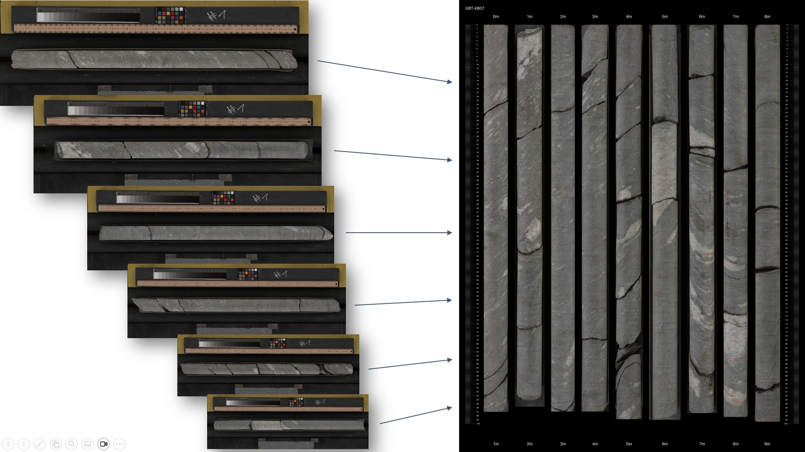
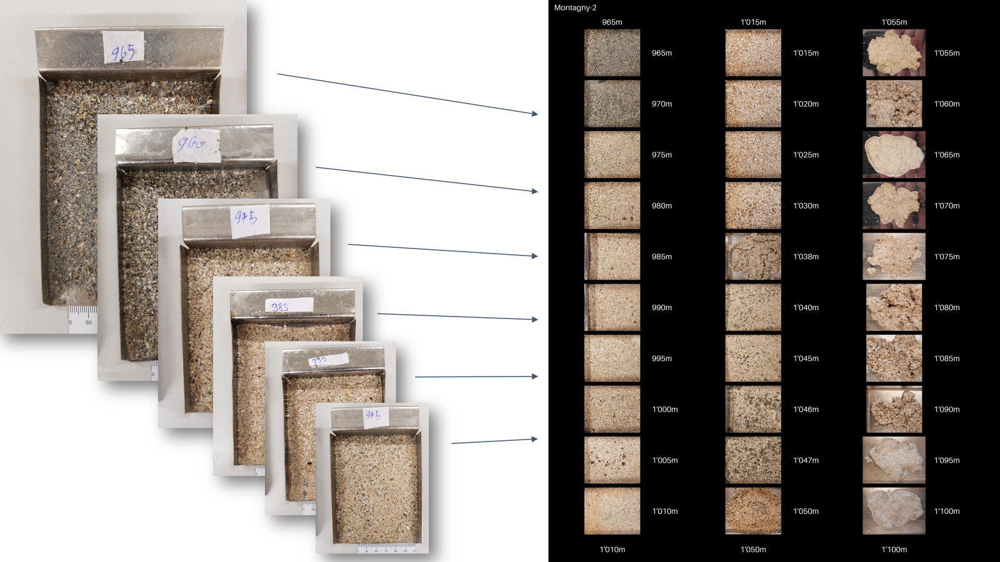

# Boreholes Photo Processor

Boreholes Photo Processor turns individual close-up photos of borehole cores and cuttings
into composite images that are more suitable for publication on [boreholes.swissgeol.ch](https://boreholes.swissgeol.ch). This
project was initiated by the Swiss Federal Office of Topography
[swisstopo](https://www.swisstopo.admin.ch/), and was developed with support from
[Visium](https://www.visium.com/).




<table>
  <tr>
    <td>
      <strong>🔍 <a href="#see">See</a></strong><br/>
      Browse examples of the published composite images, as generated by this pipeline.
    </td>
    <td>
      <strong>💡 <a href="#understand">Understand</a></strong><br/>
      How the pipeline works internally and the assumptions it relies on.
    </td>
    <td>
      <strong>▶️ <a href="#run">Run</a></strong><br/>
      Install the dependencies and run the cores and cuttings pipelines yourself.
    </td>
    <td>
      <strong>🤝 <a href="#contribute">Contribute</a></strong><br/>
      What you need to know before contributing code to this project.
    </td>
  </tr>
</table>

## See

Composite cuttings images generated by this pipeline have been published on
[boreholes.swissgeol.ch](https://boreholes.swissgeol.ch) for the following boreholes:

- [Forsthaus GES-F1](https://boreholes.swissgeol.ch/49502/attachments#photos)
- [Forsthaus GES-F2](https://boreholes.swissgeol.ch/49537/attachments#photos)
- [Forsthaus GES-F3](https://boreholes.swissgeol.ch/49504/attachments#photos)
- [Forsthaus GES-F3A](https://boreholes.swissgeol.ch/49505/attachments#photos)
- [GEo-01](https://boreholes.swissgeol.ch/36243/attachments#photos)
- [GEo-02](https://boreholes.swissgeol.ch/36244/attachments#photos)
- [Montagny-2](https://boreholes.swissgeol.ch/36258/attachments#photos)
- [Montagny-2 ST](https://boreholes.swissgeol.ch/36259/attachments#photos)
- [Vinzel-1](https://boreholes.swissgeol.ch/36262/attachments#photos)
- [Vinzel-1 Malm](https://boreholes.swissgeol.ch/36264/attachments#photos)
- [Vinzel-1S](https://boreholes.swissgeol.ch/36263/attachments#photos)

The publication of the processed core photos will follow shortly — links will be added here
as soon as they are available.

## Understand

The pipeline processes cores and cuttings as two independent sub-pipelines, each with a
collect → segment → stitch flow:

- **Cores** — segmentation detects the core, the wooden tray, and the depth ruler in each
  photo. Tesseract OCR reads the ruler's printed tick numbers to calibrate a
  pixels-per-metre scale, so every core is resized to a consistent physical scale and the
  output sheets carry accurate depth rulers.
- **Cuttings** — each photo is cropped around the cuttings region using one of four
  segmentation methods (`full`, `black_circle`, `pebble`, `tray`), chosen per borehole to
  match the physical layout used at that site, then arranged into fixed-size grid pages.

For a full description of how the pipeline works internally — the segmentation algorithms,
the stitching layout, and the assumptions they rely on (filename conventions, static camera
per shape group, override escape hatch, and more) — see
[docs/ARCHITECTURE.md](docs/ARCHITECTURE.md).

## Run

### Installation

In a first step you need to clone the repository:

```bash
#using https
git clone https://github.com/swisstopo/swissgeol-boreholes-photo-processor.git
```

#### OCR

The pipeline uses OCR to read the printed tick numbers on the depth ruler in each photo.

```bash
# Install Tesseract OCR engine (system-level)
# On Ubuntu/Debian:
sudo apt-get install -y tesseract-ocr=5.3.4*

# On macOS:
brew install tesseract

# On Windows: download installer from
# https://github.com/UB-Mannheim/tesseract/wiki
```

#### Python

We use [uv](https://docs.astral.sh/uv/) to manage package dependencies. Install uv first if you haven't already:

```bash
curl -LsSf https://astral.sh/uv/install.sh | sh
```

The below commands will install the package for you:
```bash
uv sync --all-extras
```

Then activate your environment:
```bash
source .venv/bin/activate
```

Adding packages can be done by editing the `pyproject.toml` of the project and adding the required package, then running `uv sync` to update the lock file.

### Pipeline

#### Expected Data Format (Cores)

The pipeline processes borehole core photos in **TIF format** (`.tif`/`.TIF`, case-insensitive). Files with other extensions are ignored.

**Filename convention**

Each image filename **must** contain a depth interval of the form `_XXXX.XX-YYYY.YY`, where `XXXX.XX` is the start depth and `YYYY.YY` is the end depth in metres. Files without this pattern are rejected at runtime.

The borehole identifier is derived from the filename prefix — everything before the depth range:

```
<borehole-id>_0015.00-0016.00_<optional-suffix>.tif
└───────────┘ └─────────────┘
 borehole_id    depth range
```

**Folder structure**

For a **single borehole**, the input directory should contain TIF files directly:

```
<any-folder>/
└── <borehole-folder>/          ← pass this as --input
    ├── <borehole-id>_0000.00-0001.00_*.tif
    ├── <borehole-id>_0001.00-0002.00_*.tif
    └── ...
```

For **batch processing** across multiple boreholes, the input directory should contain one subdirectory per borehole:

```
<any-folder>/                   ← pass this as --input
├── <borehole-folder-1>/
│   ├── <borehole-id-1>_0000.00-0001.00_*.tif
│   └── ...
└── <borehole-folder-2>/
    ├── <borehole-id-2>_0000.00-0001.00_*.tif
    └── ...
```

The pipeline detects the mode automatically: if the input directory contains subdirectories it runs in batch mode, otherwise it processes the directory as a single borehole. The input folder structure is mirrored in the output directory.

**Manually cropped overrides**

Prefix a filename with `override_` (e.g. `override_GBC-CB50_0015.00-0016.00_vd_p.tif`) to supply an already-cropped image for that depth range instead of letting the pipeline segment it automatically; it wins over any other file at the same range. It must still be a `.tif`, since it's scaled like any other core with no detected ruler (the batch's fallback scale).

#### Expected Data Format (Cuttings)

The pipeline processes cuttings photos in **JPG, JPEG, BMP, TIF, and TIFF format** (case-insensitive). Files with other extensions are ignored.

**Filename convention**

New data should follow this convention:

```
<borehole-id>_<depth>m_<sequence>.<ext>
```

e.g. `VINZEL-1_1234.50m_01.jpg` — `depth` is the point depth in metres (decimal allowed), and
`sequence` should be incremented for every extra photo taken at the same depth.

A number of legacy, borehole-specific filename conventions are also recognized for existing data
(e.g. an id followed by a depth range, an id and depth separated by a space, or a camera filename
with the depth appended as a trailing token) — see `ImageMetadataCuttings.from_path` in
`src/models.py` for the full list. Filenames with no recoverable depth are skipped with a warning,
not fatal to the whole batch. Files named `00-Vials-*` are always excluded outright, since they're
sample-vial photos rather than depth photos.

Only the first photo (by filename) found at a given depth is kept; any extra photos at the same
depth are dropped and the count is logged (and, with `--mlflow`, recorded as a metric). Naming every
photo at a shared depth with the convention above (unique, incrementing `sequence`) avoids this.

**Manually cropped overrides**

Prefix a filename with `override_` (e.g. `override_1234.50m_01.jpg`) to supply an already-cropped image for that depth instead of letting the pipeline crop it automatically; it wins over any other file at the same depth.

**Folder structure**

Same as for cores above: a single borehole folder of cuttings photos, or one subfolder per borehole
for batch processing.

#### Output

Each output sheet places a variable number of cores side by side, respecting a minimum
separation between them, top-aligned on a black background, with a ruler (major, intermediate,
and minor ticks) drawn along both the left and right edges, and the borehole ID printed in the
top-left corner. Depth values are shown separately as `depth_start`/`depth_end` labels (in
metres) above and below each core strip.

The depth ruler is calibrated automatically: Tesseract OCR reads the printed tick numbers on each
photo's ruler to derive a pixels-per-unit scale (`px_per_unit`), so tick counts and labels reflect
actual detected depth rather than an arbitrary scale. Each core is then resized independently using
its own detected `px_per_unit` (falling back to the batch median if no ruler was detected for that image), and clamped if it would exceed `max_core_width`/`max_core_height`.

A core's depth labels are suffixed with `*` when its scale could not be trusted. Either no ruler
was detected for that image (falling back to the batch median scale) or the crop had to be clamped.

### Configuration

Segmentation, stitching and evaluation parameters are set via a YAML config file,
not CLI flags. A default [config.yaml](config.yaml) is provided at the repository root;
any omitted key falls back to its default (see `src/config.py`).

To speed up segmentation, images are downscaled before each detection step (tray, core-trim,
and ruler OCR each have their own `downscale_factor` under `segmentation.*` in `config.yaml`),
and resulting bounding boxes are scaled back up to the original resolution for stitching.

The pipeline groups images by their on-disk shape (height, width, channels) and, for each
group with at least `10` images, derives a shared bounding box by comparing images from the
(assumed static) camera position and locating the region that changes between shots (the
core/tray). Groups with fewer than `10` images fall back to per-image thresholding instead.
Per-image preprocessing for these shape groups (tray detection and ruler OCR) runs in parallel
across `segmentation.n_workers` worker processes, controlling which images are sampled from each group.

To use a different config file, pass `--config <path>` (see below).

### CLI Usage

The commands below assume the package is installed (see [Installation](#installation)). Without installing it,
run the same commands via `uv run python -m src.run cores ...` / `uv run python -m src.run cuttings ...` instead.

#### Run the pipeline for cores:

**Standard**

```bash
uv run boreholes-photo-processor --input <input-dir> --output <output-dir>
```

- `--input`: Path to the directory containing raw borehole photos (`.tif` only), or nested folders containing them
- `--output`: Path to the directory where processed images will be written
- `--config`: Path to the YAML config file for segmentation, stitching, and evaluation parameters (default: `config.yaml`)

**With In-Memory processing (faster)**

For faster runtime, use the `--cache` flag to eagerly decode and cache each core/cutting crop
during the (already-parallel) segmentation step, instead of deferring that work to stitching.
This requires enough available memory to hold every processed crop at once. On a standard
machine (32 GB), we recommend in-memory processing only for folders of 16 GB or less to avoid
out-of-memory errors.

```bash
uv run boreholes-photo-processor --input <input-dir> --output <output-dir> --cache
```

**With MLflow tracking**

```bash
uv run boreholes-photo-processor --input <input-dir> --output <output-dir> --mlflow --debug
```

- `--mlflow`: Enable MLflow artifact logging. By default logs to `./mlruns`; set `MLFLOW_TRACKING_URI` for a remote server.
- `--debug`: Additionally log per-image and per-shape-group debug images (core/tray/ruler overlays) under a `debug` subfolder of each run's artifacts. Only has an effect when `--mlflow` is also set.


To view logged artifacts, start the MLflow UI:
```bash
uv run mlflow ui
```

Then open http://localhost:5000 in your browser.


#### Run the pipeline for cuttings

**Without MLflow tracking**

```bash
uv run boreholes-photo-processor-cuttings --input <input-dir> --output <output-dir> --cut-type pebble
```

- same flags as for the cores
- `--cut-type`: Cuttings segmentation method to use — `full` (default, no cropping, the entire
  image is used), `black_circle` (cuttings inside a black circular tray), `pebble` (cuttings next
  to a printed reference paper sheet) or `tray` (cuttings inside a metal tray). Must match the
  physical layout used at that borehole; there's no auto-detection.
- `--dedup-keep`: `first` or `last` — which image to keep (by filename) when multiple cuttings
  images share the same depth. Overrides `segmentation.cuttings.dedup_keep` from `--config` for
  this run; defaults to that config value when omitted.

**With MLflow tracking**

```bash
uv run boreholes-photo-processor-cuttings --input <input-dir> --output <output-dir> --mlflow --debug
```

- same flags as for the cores

#### Batch scripts

To (re)generate output for every borehole at once — e.g. at the end of the project:

**Cores** — every borehole uses the same command, so a loop is enough, no script needed:

```bash
for borehole_dir in <input-root>/*/; do
  borehole=$(basename "$borehole_dir")
  uv run boreholes-photo-processor --input "$borehole_dir" --output "<output-root>/$borehole"
done
```

**Cuttings** — each borehole needs its own `--cut-type`, so use
[scripts/run_all_cuttings.sh](scripts/run_all_cuttings.sh):

```bash
scripts/run_all_cuttings.sh <input-root> <output-root> [extra flags...]
```

- `<input-root>/<borehole>` must contain that borehole's raw cuttings photos
- output is written to `<output-root>/<borehole>/`
- any other flags (`--mlflow`, `--debug`, `--cache`) are forwarded as-is to every run

The script is a plain list of commands, one per borehole, not a generic tool — each
borehole's `--cut-type` (and, where needed, `--dedup-keep`) is hardcoded to match its
physical setup / data. Add a line for each new borehole as it comes in.

## Contribute

### Project management

This project is managed and financed by the Swiss Federal Office of Topography [swisstopo](https://www.swisstopo.admin.ch/). Project lead is Stijn Vermeeren [@stijnvermeeren-swisstopo](https://www.github.com/stijnvermeeren-swisstopo). Many contributions come from [Visium](https://www.visium.com/), in their role as contractor for swisstopo for this project. See [contributors](https://github.com/swisstopo/swissgeol-boreholes-photo-processor/graphs/contributors) for all individual contributors.

We welcome feedback, bug reports and code contributions (provided they are compatible with swisstopo's roadmap) from third parties. Please note that there is currently no budget allocated for active development of this project — contributions from swisstopo will be limited to essential maintenance.

### License

This project is released as open source software, under the principle of "_public money, public code_", in accordance with the 2023 federal law "[_EMBAG_](https://www.fedlex.admin.ch/eli/fga/2023/787/de)", and following the guidance of the [tools for OSS published by the Federal Chancellery](https://www.bk.admin.ch/bk/en/home/digitale-transformation-ikt-lenkung/bundesarchitektur/open_source_software/hilfsmittel_oss.html).

The source code is licensed under the [MIT License](LICENSE).

### Guidelines

Before submitting changes, please:

- **Read the architecture docs first.** [docs/ARCHITECTURE.md](docs/ARCHITECTURE.md)
  describes the pipeline's internal data flow, the design decisions behind it, and the
  assumptions the code relies on (filename conventions, shape grouping, scale fallbacks).
  Most changes touch one of these invariants — know which one you're touching.
- **Set up the dev environment** as described in [Run](#run), then install the dev
  dependencies (already included via `uv sync --all-extras`) and the pre-commit hooks:

  ```bash
  uv run pre-commit install
  ```

  The hooks run [Ruff](https://docs.astral.sh/ruff/) (linting + formatting, config in
  `pyproject.toml`) and [ty](https://docs.astral.sh/ty/) (type checking) on every commit.
  You can also run them manually on all files with `uv run pre-commit run --all-files`.
- **Add tests for behavior changes.** The test suite lives in `tests/` and mirrors the
  structure of `src/`. Run it with:

  ```bash
  uv run pytest tests/
  ```

  To also generate a coverage report:

  ```bash
  uv run pytest --cov=src tests/
  ```

- **Keep configuration in `config.yaml` / `src/config.py`.** New tunable parameters belong
  there, not in CLI flags — a config file is the single source of truth for a run.
- **Update the docs when behavior changes:** this README for user-facing changes
  (installation, CLI, data formats, output layout), and
  [docs/ARCHITECTURE.md](docs/ARCHITECTURE.md) for internal design or assumption changes.
